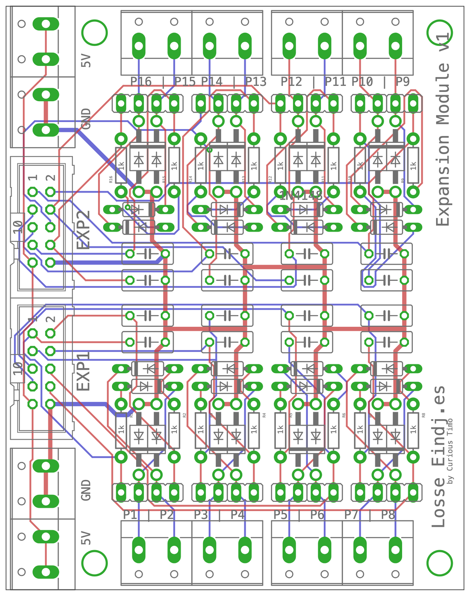

# Arduino LocoNet Expansion Module v1

A general-purpose expansion for the [Arduino Nano LocoNet & DCC Interface v3](../Arduino%20LocoNet-DCC%20Interface%20v3) (or a v2 with the [v2 Expansion Adapter](../Arduino%20LocoNet-DCC%20v2%20Expansion%20Adapter)). It connects with two 10-pin flat cables to **EXP1** and **EXP2** and brings sixteen Nano pins out to screw terminals, **P1 to P16**, plus 5 V and GND terminals.

The board is made for different setups: **you only fit the parts your project needs**, chosen per terminal. A terminal can be a plain connection to the Nano pin (for an output, a button, a servo signal) or a protected input (for Märklin contact tracks or reed contacts), and one board can mix both.

Designed in EAGLE 9.6.2: the schematic and the board are in [`Eagle/`](Eagle), the Gerber files (31 January 2021) for ordering the board in [`Gerber/`](Gerber). Board 65.7 × 83.8 mm, two layers, through-hole parts only.



*The board from above, drawn from the EAGLE file: red tracks on top, blue underneath, green pads, grey the printing on the board.*

## Fitting the board for your task

Every terminal has the same places for parts. Choose for each terminal:

| Use | Fit | Leave empty |
| --- | --- | --- |
| **Plain connection**: an output (an LED with its own resistor, a servo signal), a push button or switch to GND, a sensor with a 5 V output | Jumper **JP** closed, or a wire bridge in its place | R, 1N4148, 1N4004, C |
| **Protected input**: Märklin contact tracks, reed contacts, anything with long wires near the track | 1 kΩ **R**, **1N4148**, **1N4004**, **C** | JP (open) |
| **Not used** | Nothing | Everything |

Fit the **terminals** you use and the **EXP** headers for the cables you need: EXP1 for P1 to P8, EXP2 for P9 to P16. The 5V and GND terminals only when something needs power from the board.

## The protected input

The full circuit of one terminal, with all its parts fitted:

```text
 Nano pin ──┬── 1 kΩ ──▶|── 1N4148 ──┬── terminal P
            │                         │
           C                       1N4004
            │                       (▲ to GND)
           GND                        │
                                     GND
     and jumper JP: Nano pin ── terminal P (bypasses the resistor and diode)
```

- The Nano pin is an input with its **internal pull-up** switched on (`pinMode(pin, INPUT_PULLUP)`).
- **Nothing connected, or the contact open:** the pin reads **HIGH**.
- **Terminal connected to GND** (a train on a Märklin contact track, a closed reed contact, a pressed button): current flows through the 1 kΩ and the 1N4148, and the pin reads **LOW**.
- **The 1N4148** keeps positive voltages on the terminal away from the Nano, for example when a wire touches the track or the 16 V lighting supply.
- **The 1N4004** takes negative voltages on the terminal to GND.
- **The capacitor** filters short spikes and contact bounce. Its value is not in the design; 100 nF is the usual choice.

**Jumper JP1 to JP16** (one per terminal, next to it) connects the Nano pin straight to the terminal, without the protection: the plain connection. Then the terminal is not protected, so never more than 5 V on it, and leave the capacitor out on outputs (it would slow down a servo signal).

## Terminals and Nano pins

| Terminal | Nano pin | Flat cable | | Terminal | Nano pin | Flat cable |
| --- | --- | --- | --- | --- | --- | --- |
| P1 | D2 | EXP1 pin 1 | | P9 | D12 | EXP2 pin 1 |
| P2 | D3 | EXP1 pin 2 | | P10 | D13 | EXP2 pin 2 |
| P3 | D4 | EXP1 pin 3 | | P11 | A0 | EXP2 pin 3 |
| P4 | D5 | EXP1 pin 4 | | P12 | A1 | EXP2 pin 4 |
| P5 | D6 | EXP1 pin 5 | | P13 | A2 | EXP2 pin 5 |
| P6 | D9 | EXP1 pin 6 | | P14 | A3 | EXP2 pin 6 |
| P7 | D10 | EXP1 pin 7 | | P15 | SDA (A4) | EXP2 pin 7 |
| P8 | D11 | EXP1 pin 8 | | P16 | SCL (A5) | EXP2 pin 8 |

Pins 9 and 10 of both flat cables are 5 V and GND. The two **5V** and two **GND** terminals on the left (top and bottom) carry them, for example to power IR or Hall sensors.

Some inputs share their Nano pin with something on the interface board:

| Terminal | Shared with | What to do |
| --- | --- | --- |
| **P1** (D2) | The DCC input | Leave P1 unused when the interface's DCC part (6N137) is fitted |
| **P4, P5** (D5, D6) | The interface's blue terminal, when its SCL/SDA jumpers are on the right | Put those jumpers on the left, or leave the blue terminal's D5/D6 unused |
| **P10** (D13) | The Nano's own LED on D13 | The LED pulls the pin down, so the pull-up does not work reliably; use P10 as an output, or leave it unused |
| **P15, P16** (A4, A5) | I2C | Not available as inputs when I2C is used (a PCA9685, the Märklin I2C Expansion). The interface's "i2c pullup" jumper may stay on; it only makes the pull-up stronger |

D0, D1 (USB) and D7, D8 (LocoNet) are not on the flat cables.

## Parts list

Fit only what you need (see [Fitting the board for your task](#fitting-the-board-for-your-task)). Per terminal:

| Part | Value | For |
| --- | --- | --- |
| R | 1 kΩ | Protected input |
| D (small glass diode) | 1N4148 | Protected input |
| D (larger black diode) | 1N4004 | Protected input |
| C | 100 nF (value not in the design), 5 mm pin spacing | Protected input |
| JP | 2-pin header and a jumper, or a wire bridge | Plain connection |

For the board:

| Part | Value | Number |
| --- | --- | --- |
| PORT1 to PORT8 | 2-pole terminal, 5.08 mm (each holds two terminals, for example P1 and P2) | 1 to 8, as needed |
| 5V-L, 5V-R, GND-L, GND-R | 2-pole terminal, 5.08 mm | As needed |
| EXP1, EXP2 | 10-pin boxed header (2 × 5, 2.54 mm) | 1 or 2 |
| | 10-pin flat cable with two connectors | 1 or 2 |

A board with all sixteen protected inputs needs 16 of each: R1 to R16, sixteen 1N4148, sixteen 1N4004 and C1 to C16.

## Software

No program in this repository uses the module yet. Reading an input in an Arduino sketch:

```cpp
const uint8_t kInputs[16] = {2, 3, 4, 5, 6, 9, 10, 11, 12, 13, A0, A1, A2, A3, A4, A5};  // P1 to P16

void setup() {
  for (uint8_t pin : kInputs) pinMode(pin, INPUT_PULLUP);
}

void loop() {
  bool occupied = digitalRead(kInputs[2]) == LOW;  // P3: LOW when the contact is closed
}
```

To report the inputs on LocoNet, send an `OPC_INPUT_REP` (sensor message) when an input changes, as LocoNet occupancy detectors do.
