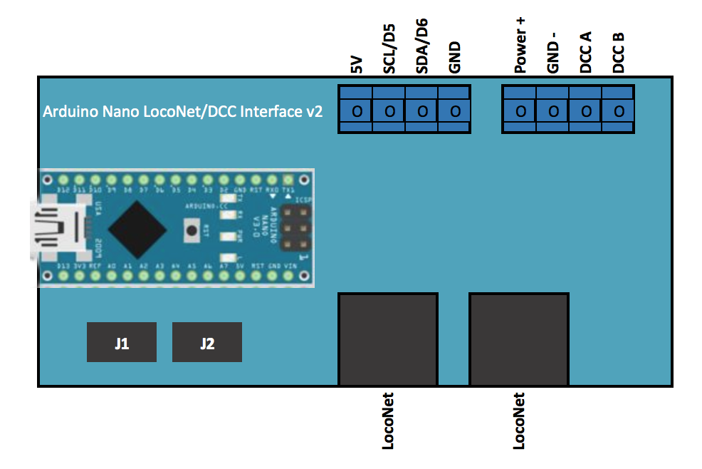
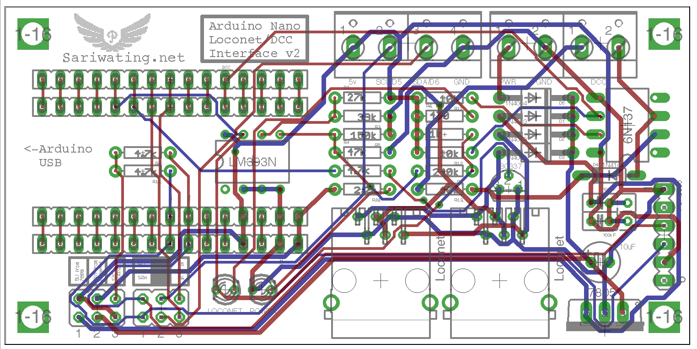
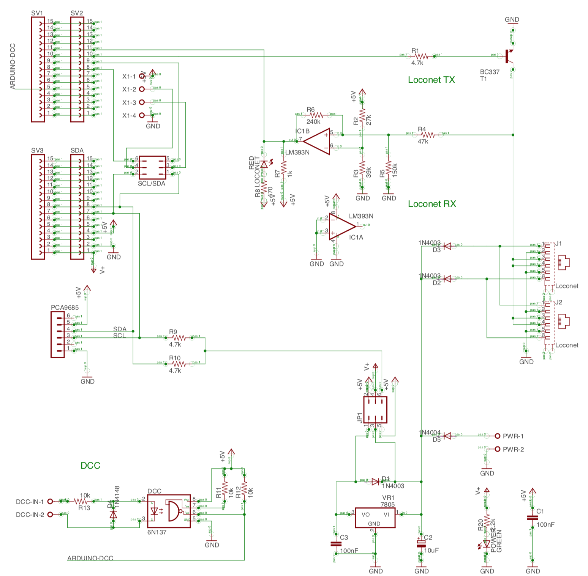

# Arduino Nano LocoNet & DCC Interface v2


[](https://youtu.be/ChiXt6e9TbQ)

A base board for model railway projects with an Arduino Nano: it connects the Nano to **LocoNet** (in and out), to **DCC** from the track or a booster, and to **I2C** devices such as a PCA9685 servo board. The board is modular: you only fit the parts for what you use.

This manual replaces the PDF [Manual Rev 1.1](Manual/Arduino%20LocoNet-DCC%20Interface%20v2%20Manual%20Rev%201.1.pdf) (2017); the jumper explanations below are checked against the schematic in [`Eagle/`](Eagle). The successor, the [v3](../Arduino%20LocoNet-DCC%20Interface%20v3), has the same circuit and jumpers plus two expansion headers.

## Connectors



| Connector | Pins | Use |
| --- | --- | --- |
| **Blue terminal, 4-pole** | 5V · SCL/D5 · SDA/D6 · GND | 5 V and either I2C or the Nano's pins D5 and D6, chosen with the **SCL/SDA** jumpers |
| **Power, 2-pole** | Power + · GND − | A separate power supply, about **9 to 15 V DC**, for the 7805 |
| **DCC, 2-pole** | DCC A · DCC B | DCC from the track or a booster; the way round does not matter |
| **2 × LocoNet** (6-pin modular sockets, RJ12; the old manual says RJ11) | | LocoNet in and out; both sockets are connected straight through |

## Jumpers

The jumpers sit at the bottom left of the board, next to the Nano's USB socket. The names below are the ones printed on the board. (The old PDF called the two blocks "J1" and "J2"; in the schematic, J1 and J2 are the LocoNet sockets.)



### Power and pull-ups: three jumpers in a row

Three pairs of pins next to each other, each with its name printed above it. A jumper is placed **upright**, on the two pins of one column.

```text
        5V from      Vin from      i2c
         7805        Loconet      pullup
        ┌─────┐      ┌─────┐      ┌─────┐
        │  ●  │      │  ●  │      │  ●  │
        │  ●  │      │  ●  │      │  ●  │
        └─────┘      └─────┘      └─────┘
```

| Jumper | When it is on | Put it on when |
| --- | --- | --- |
| **5V from 7805** | The board's 7805 regulator powers the Nano's 5 V | The board gets its power from LocoNet or the power terminal, and the 7805 is fitted. **This is the usual setting.** |
| **Vin from Loconet** | LocoNet's RailSync and the power terminal (each through a diode) go to the Nano's VIN pin, so the Nano's own small regulator makes the 5 V | The 7805 is **not** fitted. Use this one *or* "5V from 7805", not both |
| **i2c pullup** | The two 4.7 kΩ pull-up resistors on SDA and SCL are connected to 5 V | I2C devices are connected that have no pull-ups of their own, for example Märklin Keyboards. A PCA9685 breakout usually has its own; with this jumper on as well it still works |

With only the USB cable connected (for example to load a program), the jumpers can stay as they are: a diode across the 7805 protects it.

### Blue terminal: I2C or D5/D6

Two rows of three pins. The middle column goes to the blue terminal; the jumpers connect it to the left (I2C) or to the right (D5 and D6). Always put **both jumpers on the same side**.

```text
  I2C on the blue terminal             D5 and D6 on the blue terminal

  SCL  ●━━━●  ○  D5                    SCL  ○  ●━━━●  D5
  SDA  ●━━━●  ○  D6                    SDA  ○  ●━━━●  D6
```

| Setting | Blue terminal pin 2 | Blue terminal pin 3 |
| --- | --- | --- |
| Both jumpers **left** | SCL (A5) | SDA (A4) |
| Both jumpers **right** | D5 | D6 |

## Pins the board uses

Leave these Nano pins free for LocoNet and DCC:

| Pin | Use |
| --- | --- |
| **D2** | DCC input (interrupt 0), from the 6N137 optocoupler |
| **D7** | LocoNet send, through the BC337 transistor |
| **D8** | LocoNet receive (the input-capture pin the LocoNet library needs), from the LM393 comparator |
| A4, A5 | I2C (SDA, SCL), when I2C is used |
| D5, D6 | The blue terminal, when its jumpers are on the right |

## Parts list

Fit only the groups you need.

| Group | Part | Value |
| --- | --- | --- |
| **Power supply** | VR1 | LM7805 |
| | R20 | 2.2 kΩ (power LED) |
| | D1 | 1N4003 (protects the 7805) |
| | D5 | 1N4004 (power terminal) |
| | C1, C3 | 100 nF |
| | C2 | 10 µF |
| | Power LED | 3 mm green |
| | PWR | 2-pole blue terminal |
| **I2C** | R9, R10 | 4.7 kΩ |
| **LocoNet** | LM393N | LM393N comparator |
| | T1 | BC337 NPN transistor |
| | R1 | 4.7 kΩ |
| | R2 | 27 kΩ |
| | R3 | 39 kΩ |
| | R4 | 47 kΩ |
| | R5 | 150 kΩ |
| | R6 | 240 kΩ |
| | R7 | 1 kΩ |
| | R8 | 470 Ω (LocoNet LED) |
| | D2, D3 | 1N4003 (RailSync to the power supply) |
| | LocoNet LED | 3 mm red |
| | J1, J2 | 6-pin modular sockets (RJ12) for LocoNet |
| **DCC** | 6N137 | 6N137 optocoupler |
| | R11, R12, R13 | 10 kΩ |
| | D4 | 1N4148 |
| | DCC | 2-pole blue terminal |

R13 limits the current through the optocoupler. At 10 kΩ it gives about 1.5 mA at 16 V DCC, while a 6N137 is only guaranteed to switch at about 5 mA; if DCC is not detected reliably, **1.5 to 2.2 kΩ** (0.25 W) is the safer value.

## Software

Programs for this board are in this repository: [LocoNet_Servo_Decoder_LNCV](../LocoNet_Servo_Decoder_LNCV), [Loconet_WS2812b_Signal_Decoder](../Loconet_WS2812b_Signal_Decoder), [Loconet_Pendelzug](../Loconet_Pendelzug), and for the v3 [Marklin-6040-LocoNet](../Marklin-6040-LocoNet). They use the **LocoNet** library (mrrwa) from the Arduino IDE's Library Manager; for the DCC input, the **NmraDcc** library (also in the Library Manager) reads pin D2. More on the [Curious Timo YouTube channel](https://www.youtube.com/curioustimo).

## Schematic



The EAGLE files are in [`Eagle/`](Eagle).

## License

Copyright 2017 Timo Sariwating (Curious Timo). All rights reserved.

Redistribution and use in source and binary forms, with or without modification, are permitted provided that the following conditions are met:

- Redistributions of product specifications, source code, and documentation must retain the above copyright notice, this list of conditions and the following disclaimer.
- Redistributions in binary form must reproduce the above copyright notice, this list of conditions and the following disclaimer in the documentation and/or other materials provided with the distribution.

THIS PRODUCT IS PROVIDED BY TIMO SARIWATING (CURIOUS TIMO) "AS IS" AND ANY EXPRESS OR IMPLIED WARRANTIES, INCLUDING, BUT NOT LIMITED TO, THE IMPLIED WARRANTIES OF MERCHANTABILITY AND FITNESS FOR A PARTICULAR PURPOSE ARE DISCLAIMED. IN NO EVENT SHALL THE COPYRIGHT HOLDER OR CONTRIBUTORS BE LIABLE FOR ANY DIRECT, INDIRECT, INCIDENTAL, SPECIAL, EXEMPLARY, OR CONSEQUENTIAL DAMAGES (INCLUDING, BUT NOT LIMITED TO, PROCUREMENT OF SUBSTITUTE GOODS OR SERVICES; LOSS OF USE, DATA, OR PROFITS; OR BUSINESS INTERRUPTION) HOWEVER CAUSED AND ON ANY THEORY OF LIABILITY, WHETHER IN CONTRACT, STRICT LIABILITY, OR TORT (INCLUDING NEGLIGENCE OR OTHERWISE) ARISING IN ANY WAY OUT OF THE USE OF THIS PRODUCT, EVEN IF ADVISED OF THE POSSIBILITY OF SUCH DAMAGE.

The views and conclusions contained in the hardware, software, and documentation are those of the authors and should not be interpreted as representing official policies, either expressed or implied, of Timo Sariwating (Curious Timo).
