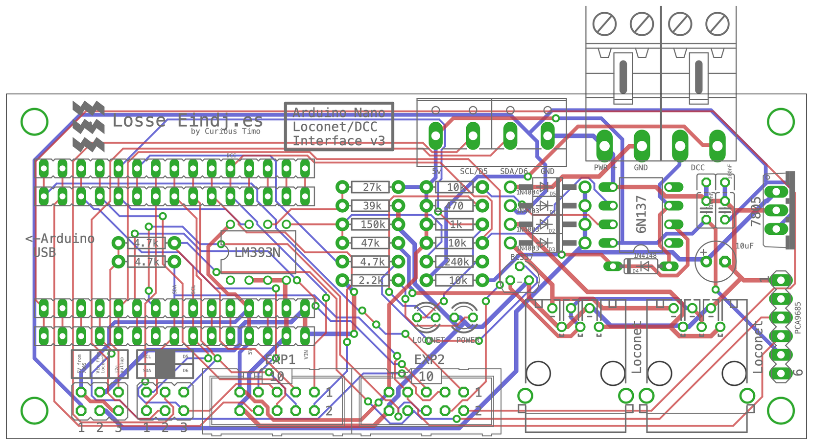

# Arduino Nano LocoNet & DCC Interface v3

The base module for LocoNet projects with an Arduino Nano: LocoNet in and out, a DCC input, I2C for servo drivers and expansion boards, and two expansion headers. It is the successor of the [v2](../Arduino%20LocoNet-DCC%20Interface%20v2) and the base of [Marklin-6040-LocoNet](../Marklin-6040-LocoNet), together with the [Märklin I2C Expansion v1](../Marklin%20I2C%20Expansion%20v1).

Designed in EAGLE 9.6.2: the schematic and the board are in [`Eagle/`](Eagle). Board 108.9 × 47 mm, two layers, through-hole parts only.



*The board from above, drawn from the EAGLE file: red tracks on top, blue underneath, green pads, grey the printing on the board.*

## On the board

| Part | What it does | Nano pin |
| --- | --- | --- |
| 2 × LocoNet socket (RJ12) | LocoNet in and out, wired straight through | |
| LocoNet receive | LM393 comparator: switches at about 4.5 V rising and 3.5 V falling on the LocoNet line; red LED shows LocoNet traffic | **D8** (the input-capture pin the LocoNet library needs) |
| LocoNet send | BC337 transistor that pulls the LocoNet line low | **D7** |
| DCC input | 6N137 optocoupler, DCC from the track or a booster on the two-pole terminal | **D2** (interrupt, as NmraDcc needs) |
| Power | 7805 regulator, fed from LocoNet RailSync or a separate power input (both through diodes); green LED | |
| I2C | 4.7 kΩ pull-ups (jumper), a 6-pin header for a PCA9685 servo board | A4 (SDA), A5 (SCL) |
| Blue 4-pole terminal | 5V · SCL/D5 · SDA/D6 · GND: either I2C or D5/D6, chosen with jumpers | |
| Power terminal (PWR +, GND) | A separate supply for the 7805, about 9 to 15 V DC | |
| DCC terminal | DCC from the track or a booster; the way round does not matter | |
| EXP1 (10-pin) | D2 (DCC), D3, D4, D5, D6, D9, D10, D11, 5 V, GND | |
| EXP2 (10-pin) | D12, D13, A0, A1, A2, A3, SDA, SCL, 5 V, GND; the Märklin I2C Expansion connects here | |

## Jumpers

The jumpers are the same as on the [v2](../Arduino%20LocoNet-DCC%20Interface%20v2#jumpers), at the same place: bottom left, next to the Nano's USB socket, with their names printed on the board.

### Power and pull-ups: three jumpers in a row

A jumper is placed **upright**, on the two pins of one column.

```text
        5V from      Vin from      i2c
         7805        Loconet      pullup
        ┌─────┐      ┌─────┐      ┌─────┐
        │  ●  │      │  ●  │      │  ●  │
        │  ●  │      │  ●  │      │  ●  │
        └─────┘      └─────┘      └─────┘
```

| Jumper | When it is on | Put it on when |
| --- | --- | --- |
| **5V from 7805** | The board's 7805 regulator powers the Nano's 5 V | The board gets its power from LocoNet or the power terminal, and the 7805 is fitted. **This is the usual setting.** |
| **Vin from Loconet** | LocoNet's RailSync and the power terminal (each through a diode) go to the Nano's VIN pin, so the Nano's own small regulator makes the 5 V | The 7805 is **not** fitted. Use this one *or* "5V from 7805", not both |
| **i2c pullup** | The two 4.7 kΩ pull-up resistors on SDA and SCL are connected to 5 V | I2C devices are connected that have no pull-ups of their own. **On for the Märklin I2C Expansion** (the Keyboard bus needs it) |

With only the USB cable connected, the jumpers can stay as they are: a diode across the 7805 protects it.

**For [Marklin-6040-LocoNet](../Marklin-6040-LocoNet):** *5V from 7805* on, *Vin from Loconet* off, *i2c pullup* on. Power the Keyboards through the expansion board's own DC-IN, not through this board.

### Blue 4-pole terminal: I2C or D5/D6

Two rows of three pins. The middle column goes to the blue terminal; always put **both jumpers on the same side**.

```text
  I2C on the blue terminal             D5 and D6 on the blue terminal

  SCL  ●━━━●  ○  D5                    SCL  ○  ●━━━●  D5
  SDA  ●━━━●  ○  D6                    SDA  ○  ●━━━●  D6
```

| Setting | Terminal "SCL/D5" | Terminal "SDA/D6" |
| --- | --- | --- |
| Both jumpers **left** | SCL (A5) | SDA (A4) |
| Both jumpers **right** | D5 | D6 |

## Parts list

Fit only the groups you need. The names are the ones on the board and in the schematic.

| Group | Part | Value |
| --- | --- | --- |
| **Power supply** | VR1 | LM7805 |
| | R20 | 2.2 kΩ (power LED) |
| | D1 | 1N4003 (protects the 7805) |
| | D5 | 1N4004 (power terminal) |
| | C1, C3 | 100 nF |
| | C2 | 10 µF |
| | POWER | 3 mm green LED |
| | PWR | 2-pole terminal, 5.08 mm |
| **I2C** | R9, R10 | 4.7 kΩ |
| | PCA9685 | 6-pin male header, for a PCA9685 servo board |
| | X1 | 4-pole terminal, 5.08 mm (the blue terminal) |
| **LocoNet** | IC1 | LM393N comparator |
| | T1 | BC337 NPN transistor |
| | R1 | 4.7 kΩ |
| | R2 | 27 kΩ |
| | R3 | 39 kΩ |
| | R4 | 47 kΩ |
| | R5 | 150 kΩ |
| | R6 | 240 kΩ |
| | R7 | 1 kΩ |
| | R8 | 470 Ω (LocoNet LED) |
| | D2, D3 | 1N4003 (RailSync to the power supply) |
| | LOCONET | 3 mm red LED |
| | J1, J2 | 6-pin modular sockets (RJ12) |
| **DCC** | DCC | 6N137 optocoupler |
| | R11, R12, R13 | 10 kΩ (R13: see below) |
| | D4 | 1N4148 |
| | DCC-IN | 2-pole terminal, 5.08 mm |
| **Nano and headers** | SV2, SV3 | 2 × 15-pin female header, for the Arduino Nano |
| | SV1, SDA | 2 × 15-pin female header next to the Nano, with every Nano pin (optional) |
| | EXP1, EXP2 | 2 × 10-pin boxed header (2 × 5, 2.54 mm), for the expansion flat cables |
| | JP1 | 2 × 3 pin header and 3 jumpers (power and pull-ups) |
| | SCL/SDA | 2 × 3 pin header and 2 jumpers (blue terminal) |
| | | Arduino Nano (ATmega328P, 5 V) |

The 6N137 and the LM393N are easier to replace in an 8-pin IC socket. R13 limits the current through the optocoupler: at 10 kΩ it gives about 1.5 mA at 16 V DCC, while a 6N137 is only guaranteed to switch at about 5 mA; if DCC is not detected reliably, **1.5 to 2.2 kΩ** (0.25 W) is the safer value.

## To check before building more

Points from a review of the v3 design; none of them stops the board from working on the bench, but they are worth looking at for a v4:

- **DCC optocoupler resistor:** 10 kΩ gives about 1.5 mA at 16 V DCC, while a 6N137 is only guaranteed to switch at about 5 mA. 1.5 to 2.2 kΩ (0.25 W) is safer.
- **Unused half of the LM393:** both inputs on GND can let its output oscillate; one input to the reference voltage is the usual fix.
- **Comparator output load:** the 1 kΩ pull-up and the 470 Ω LED together draw about 11 mA from the LM393's output, at the upper end of what it does comfortably.
- **No protection** (TVS diode or polyfuse) on LocoNet.
- **Power budget:** the 7805 runs warm when it also has to feed expansion boards; heavy loads are better fed separately.
