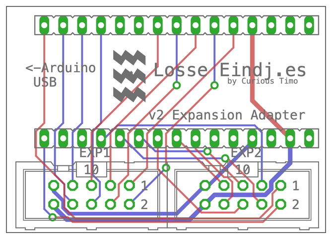

# Arduino LocoNet-DCC v2 Expansion Adapter

Gives an [Arduino Nano LocoNet & DCC Interface v2](../Arduino%20LocoNet-DCC%20Interface%20v2) the two expansion headers of the [v3](../Arduino%20LocoNet-DCC%20Interface%20v3), **EXP1** and **EXP2**, so expansion boards made for the v3 work on a v2 with the same 10-pin flat cable, for example the [Märklin I2C Expansion v1](../Marklin%20I2C%20Expansion%20v1) for [Marklin-6040-LocoNet](../Marklin-6040-LocoNet).

Designed in EAGLE 9.6.2: the schematic and the board are in [`Eagle/`](Eagle). Board 42.9 × 30.5 mm, two layers.

*The board from above, drawn from the EAGLE file: red tracks on top, blue underneath, green pads, grey the printing on the board.*

## How it fits

The adapter sits between the v2 board and the Arduino Nano:

1. Solder two **15-pin stackable headers** into the adapter (sockets on top, long pins underneath), and the two 10-pin headers EXP1 and EXP2.
2. Plug the adapter into the v2's Nano sockets, with the "<-Arduino USB" marking on the same side as the v2's.
3. Plug the Nano into the adapter.

Every Nano pin reaches the v2 board through the long pins; the adapter only takes the pins below off to the expansion headers. LocoNet (D7, D8) and the serial port (D0, D1) are not on the headers and stay free for the v2.

## Expansion headers

Wired exactly as on the v3, so a flat cable fits either board:

| Pin | EXP1 | EXP2 |
| --- | --- | --- |
| 1 | D2 (DCC input) | D12 |
| 2 | D3 | D13 |
| 3 | D4 | A0 |
| 4 | D5 | A1 |
| 5 | D6 | A2 |
| 6 | D9 | A3 |
| 7 | D10 | SDA (A4) |
| 8 | D11 | SCL (A5) |
| 9 | 5 V | 5 V |
| 10 | GND | GND |

D5 and D6 are also on the v2's blue terminal when its SCL/SDA jumpers are on the right, and SDA and SCL when they are on the left (see the [v2 jumpers](../Arduino%20LocoNet-DCC%20Interface%20v2#jumpers)); don't use the same pin on both.

## With the Märklin I2C Expansion

Connect the expansion to **EXP2**, and on the v2 put the **i2c pullup** jumper on (the Keyboard bus needs it). The rest is as described for the [Märklin I2C Expansion](../Marklin%20I2C%20Expansion%20v1).
