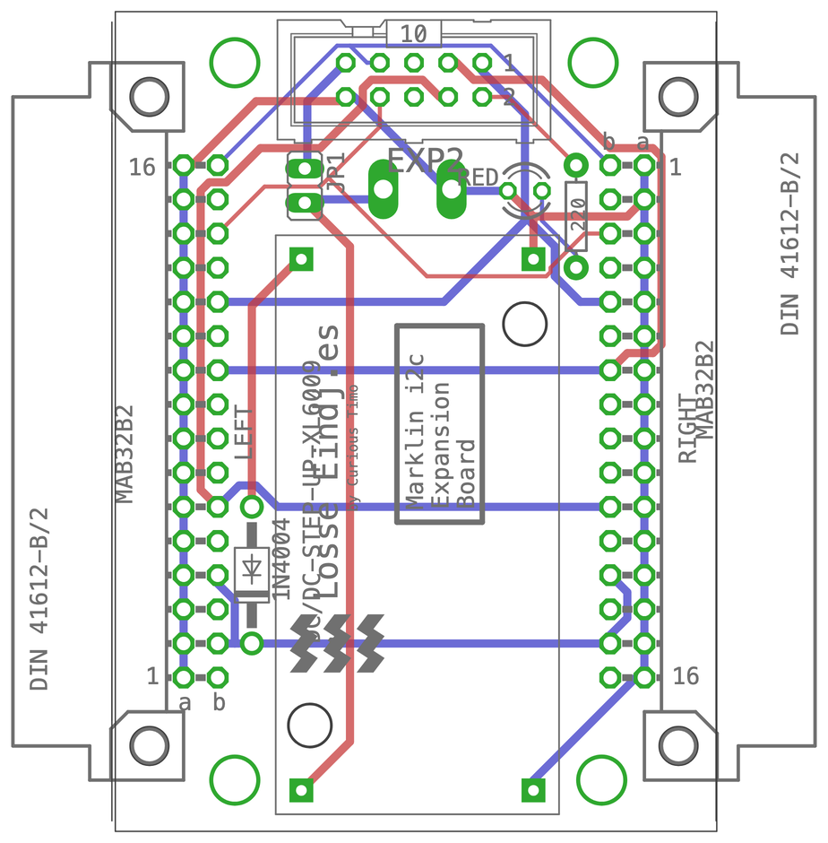

# Märklin I2C Expansion v1

An expansion for the [Arduino Nano LocoNet & DCC Interface v3](../Arduino%20LocoNet-DCC%20Interface%20v3) (or a v2 with the [v2 Expansion Adapter](../Arduino%20LocoNet-DCC%20v2%20Expansion%20Adapter)) that connects Märklin Keyboards 6040 (the Märklin Digital accessory bus, I2C) to the Nano. Used by [Marklin-6040-LocoNet](../Marklin-6040-LocoNet), which makes unmodified Keyboards 6040 work on LocoNet like an Uhlenbrock IB-Switch.

Designed in EAGLE 9.6.2: the schematic and the board are in [`Eagle/`](Eagle). Board 44.8 × 61 mm, two layers.

*The board from above, drawn from the EAGLE file: red tracks on top, blue underneath, green pads, grey the printing on the board.*

## On the board

- **Two DIN 41612 connectors** (left and right, 32-pole B/2), for the Keyboards' side connectors: SDA, SCL, STOP, GO, INIT and 8 V. The left and right connectors are mirrored, so a Keyboard fits on either side, and further Keyboards plug onto each other as usual.
- **XL6009 step-up converter** that makes the Keyboards' 8 V, through a 1N4004 diode.
- **10-pin ribbon cable** to the interface board's **EXP2**: STOP to D12, GO to A0, INIT to A1, a red LED to D13, SDA and SCL to A4 and A5, plus 5 V and GND.
- **DC-IN** two-pole terminal and jumper **JP1**.

## Before switching on

1. Close the **"i2c pullup"** jumper on the interface board: the Keyboard bus needs pull-ups to 5 V.
2. Feed **DC-IN with 5 V** and leave **JP1 open**. Each Keyboard draws about 120 mA at 8 V, which is too much for the interface board's 7805 or for LocoNet.
3. **Never more than 5 V on DC-IN with JP1 closed:** JP1 connects DC-IN to the Nano's 5 V.
4. Give every Keyboard its own number with the four switches on its back (see the table in the [Marklin-6040-LocoNet README](../Marklin-6040-LocoNet#setting-up)).

## To check before building more

- **STOP, GO and INIT** go straight to Nano pins. Measure their voltage on a Keyboard bus before using them (the firmware leaves STOP and GO switched off until then).
- **JP1** connects DC-IN to the Nano's 5 V without protection; a marking on the board ("5 V only") or a diode would help.
