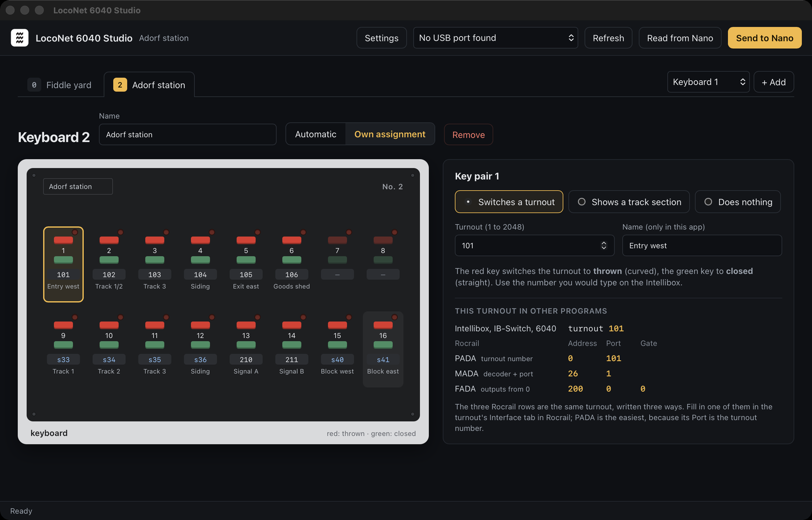

# Marklin-6040-LocoNet

Use a **Märklin Keyboard 6040** as a LocoNet switch panel, the way an **Uhlenbrock IB-Switch** works: its keys switch turnouts over LocoNet, and its lights show the turnouts' positions, whoever switched them (an Intellibox, Rocrail, a throttle or another panel). A key pair can also show a **LocoNet occupancy detector** instead: red occupied, green free.

An Arduino Nano takes the place of the Märklin central (6021) on the Keyboards' I2C bus. It answers the Keyboards as the central would and turns each key into a LocoNet switch command. Up to 16 Keyboards can share the bus, each with its own number.

The Keyboards stay unmodified. The earlier [Loconet_6040_PCA9685](../Loconet_6040_PCA9685) in this repository replaced a Keyboard's own electronics with an Arduino instead; that only makes sense for a Keyboard whose electronics are broken.

> **Status:** version 0.2.0, built and unit-tested on a computer; not yet tested with a real Keyboard 6040 or LocoNet.

## Hardware

- **Arduino Nano LocoNet/DCC Interface v3**: the LocoNet base module with an Arduino Nano (LocoNet receive on D8, send on D7).
- **Märklin I2C Expansion Board v1**: connects to the interface board's **EXP2** with a 10-pin ribbon cable, and to the Keyboards through their DIN 41612 side connectors (left or right). Its step-up converter makes the Keyboards' 8 V.

Both boards are my own designs (Curious Timo, Losse Eindj.es), made in Eagle.

Before switching on:

1. Close the **"i2c pullup"** jumper on the interface board: the Keyboard bus needs pull-ups to 5 V.
2. Power the Keyboards from the expansion board's **DC-IN** with a 5 V supply and **JP1 open**. Each Keyboard draws about 120 mA at 8 V; that is too much for the interface board's 7805 or for LocoNet. With JP1 closed, DC-IN is connected to the Nano's 5 V, so it must never get more than 5 V.
3. Give every Keyboard its own number, 1 to 16, with the four switches on its back (see **Setting up**, step 2).

## Loading the program without the Arduino IDE

You don't need the Arduino IDE or any programming. Every Nano gets the same ready-made program; what your Keyboards do is set up afterwards (see **Setting up**).

1. Download `Marklin-6040-LocoNet-x.y.z.hex` from the [Releases](https://github.com/CuriousTimo/Arduino-ModelRail/releases) page (the newest "Marklin-6040-LocoNet" release).
2. Connect the Nano to the computer with its USB cable.
3. Load the file onto the Nano with one of the tools below.

**Windows: XLoader.** A small free program (search for "XLoader Arduino"; it needs no installation).

1. **Hex file:** choose the downloaded `.hex` file.
2. **Device:** `Duemilanove/Nano(ATmega328)`. If the upload fails, try `Uno(ATmega328)` (see the note below).
3. **COM port:** the Nano's port (in the Device Manager under "Ports (COM & LPT)").
4. Click **Upload**. After a few seconds it says how many bytes were uploaded.

**Mac and Linux: avrdude.** Install it once: on a Mac `brew install avrdude` ([Homebrew](https://brew.sh)), on Debian, Ubuntu or Raspberry Pi OS `sudo apt install avrdude`. Then, in the folder with the downloaded file:

```sh
avrdude -p atmega328p -c arduino -P /dev/cu.usbserial-XXXX -b 57600 -U flash:w:Marklin-6040-LocoNet-0.2.0.hex:i
```

Replace `/dev/cu.usbserial-XXXX` with the Nano's port (on a Mac `ls /dev/cu.*`, on Linux usually `/dev/ttyUSB0`) and the file name with the one you downloaded. It ends with `avrdude done. Thank you.`

**Old or new bootloader:** most Nanos, and nearly all clones, have the old bootloader, which loads at 57600 baud (`Duemilanove/Nano` in XLoader, `-b 57600` for avrdude). Newer original Nanos load at 115200 baud: choose `Uno(ATmega328)` in XLoader, or `-b 115200` for avrdude. If one doesn't work, try the other; nothing breaks.

Then open a serial terminal at 115200 baud (or LocoNet 6040 Studio) and continue with **Setting up**.

## Building the program yourself

For those who want to change the program:

1. In the Arduino IDE, install the **LocoNet** library by Alex Shepherd et al. (mrrwa) from the Library Manager (tested with 1.1.13). `Wire` and `EEPROM` come with the IDE.
2. Open `Marklin-6040-LocoNet.ino`.
3. Choose **Arduino Nano** as the board (with a clone, processor **ATmega328P (Old Bootloader)**) and upload.
4. Set up the Keyboards from the Serial Monitor, as described under **Setting up** below.

With the Arduino command line:

```sh
arduino-cli lib install LocoNet@1.1.13
arduino-cli compile --fqbn arduino:avr:nano .
arduino-cli upload --fqbn arduino:avr:nano:cpu=atmega328old -p /dev/cu.usbserial-XXXX .
```

GitHub builds the program on every change (`.github/workflows/marklin-6040-loconet.yml`, with Arduino AVR Boards 1.8.6 and LocoNet 1.1.13) and attaches the `.hex` to each release.

## Setting up

**The easiest way: [LocoNet 6040 Studio](https://github.com/CuriousTimo/LocoNet-6040-Studio).** A program for your computer that shows your Keyboards as they look, lets you click a key pair and choose what it does, and sends the setup to the Nano over its USB cable. It also reads the setup back from the Nano and keeps it as a file.

[](https://github.com/CuriousTimo/LocoNet-6040-Studio)

| | |
| --- | --- |
| [](https://github.com/CuriousTimo/LocoNet-6040-Studio) | [](https://github.com/CuriousTimo/LocoNet-6040-Studio) |
| A key pair that shows a track section: red while a train is there, green when the track is free. | The settings of the Nano, each with a plain explanation. |

Each Keyboard is drawn as it looks, with its red LEDs and the four switches on its back set for its number. For every turnout the Studio also shows how Rocrail writes it (PADA, MADA and FADA).

The rest of this section describes the other way: typing commands on the Serial Monitor of the Arduino IDE.

You set up the Keyboards from your computer, with the USB cable that is also used to load the program onto the Nano. You only need to do this once: the Nano remembers everything, also when the power is off and when a newer version of the program is loaded.

If you are happy with Keyboard 1 switching turnouts 1 to 16, Keyboard 2 switching 17 to 32 and so on, there is nothing to set up at all. Step 1 and 2 are then only a check.

### Step 1: Talk to the Nano

1. Connect the Nano to the computer with the USB cable.
2. In the Arduino IDE, open the **Serial Monitor**: menu **Tools → Serial Monitor**.
3. At the bottom right of the Serial Monitor, choose **115200 baud**.
4. Press the reset button on the Nano. It greets you:

   ```text
   Märklin Keyboard 6040 on LocoNet, Marklin-6040-LocoNet 0.2.0
   Keyboards found: 1 2
     keyboard 1: switches 1 to 16
     keyboard 2: switches 17 to 32
   Type `help` for the commands.
   ```

5. You give a command by typing it in the input line of the Serial Monitor and pressing **Enter**. Every command you type is repeated in the window with a `>` in front of it, followed by the Nano's answer. Small or capital letters both work.

### Step 2: Check that every Keyboard is found

Every Keyboard has a number from **1 to 16**, set with the four small switches on its back, as in Märklin's own table. Two Keyboards must never have the same number. The number has nothing to do with where the Keyboard sits in the row.

| Keyboard | Switches ON | | Keyboard | Switches ON |
| --- | --- | --- | --- | --- |
| 1 | none (all off) | | 9 | 4 |
| 2 | 1 | | 10 | 1, 4 |
| 3 | 2 | | 11 | 2, 4 |
| 4 | 1, 2 | | 12 | 1, 2, 4 |
| 5 | 3 | | 13 | 3, 4 |
| 6 | 1, 3 | | 14 | 1, 3, 4 |
| 7 | 2, 3 | | 15 | 2, 3, 4 |
| 8 | 1, 2, 3 | | 16 | 1, 2, 3, 4 |

This is Märklin's table from the Keyboard's manual and the Märklin Digital book. [LocoNet 6040 Studio](https://github.com/CuriousTimo/LocoNet-6040-Studio) draws the switches for every Keyboard.

The greeting lists the Keyboards the Nano found ("Keyboards found: 1 2"). If one is missing, check its plug, its switches and the power supply, then type:

```text
scan
```

and the Nano looks again. A Keyboard is also found as soon as you press one of its keys.

### Step 3: Choose what each key switches

Each Keyboard has **16 key pairs** in two rows of 8: a red key above a green key, with the number printed between them, **1 to 8 in the top row and 9 to 16 in the bottom row**. Red switches a turnout to **thrown** (curved), green to **closed** (straight).

Without setup, each Keyboard switches 16 turnouts in a row:

| Keyboard | Switches turnouts |
| --- | --- |
| 1 | 1 to 16 |
| 2 | 17 to 32 |
| 3 | 33 to 48 |
| … | 16 more for each next Keyboard |
| 16 | 241 to 256 |

The turnout number is the one you would type on the Intellibox to switch that turnout (the turnout address, not the decoder address).

To change this, type one of the commands below. **The first number is always the Keyboard, then the key pair, then the turnout.**

| You want | Type |
| --- | --- |
| Keyboard 2 switches turnouts 101 to 116 | `set 2 all 101` |
| Key pair 5 of Keyboard 2 switches turnout 210 | `set 2 5 210` |
| Key pair 7 of Keyboard 2 does nothing | `set 2 7 0` |
| Key pair 9 of Keyboard 2 shows whether track section 33 is occupied | `sensor 2 9 33` |
| Keyboard 3 shows 16 track sections, numbers 101 to 116 | `sensor 3 all 101` |
| Keyboard 2 goes back to the table above | `clear 2` |

When you change one key pair, the other key pairs of that Keyboard keep what they had.

**Track sections (occupancy):** a key pair set with `sensor` does not switch anything. Its lamps show a track occupancy detector or a track contact on LocoNet, for example one of the Intellibox's s88 modules: **red** when a train is there, **green** when the track is free.

### Step 4: Check what you set

Type `show` for all Keyboards, or `show 2` for Keyboard 2 only:

```text
> show 2
Keyboard 2, on the bus, own assignment
  key:         1     2     3     4     5     6     7     8     9    10    11    12    13    14    15    16
  switch:    101   102   103   104   210   106     -   108   s33   110   111   112   113   114   115   116
```

The `key:` line has the key pair numbers (1 to 16, as printed on the Keyboard), the `switch:` line below it what each one does:

- a number: the turnout it switches (key pair 5 switches turnout 210)
- `-`: it does nothing (key pair 7)
- `s` and a number: it shows that track section (key pair 9 shows section 33)

### Another way: write it down in a file

Instead of typing commands, you can write the whole key map down in the file **`KeyMap.h`** and load it onto the Nano together with the program. This is handy when you set up several Nanos the same way, or want to keep your setup with the program.

1. Open `KeyMap.h` in the Arduino IDE (it is one of the tabs next to the program).
2. Change `kUseKeyMap = false` to `kUseKeyMap = true`.
3. Write one line per Keyboard: first its number, then what its 16 key pairs do, in the order of the numbers printed on the Keyboard (1 to 8 in the top row, then 9 to 16 in the bottom row). A number is a turnout, `0` is nothing, `SENSOR(33)` shows track section 33:

   ```cpp
   const KeyMapLine kKeyMap[] PROGMEM = {
       // Keyboard 1 switches turnouts 1 to 16.
       {1, {1, 2, 3, 4, 5, 6, 7, 8, 9, 10, 11, 12, 13, 14, 15, 16}},

       // Keyboard 2: a station. Key pairs 1 to 8 switch its turnouts, 9 and 10 do nothing,
       // 11 to 16 show its six tracks.
       {2, {101, 102, 103, 104, 105, 106, 107, 108, 0, 0,
            SENSOR(33), SENSOR(34), SENSOR(35), SENSOR(36), SENSOR(37), SENSOR(38)}},
   };
   ```

4. Load the program onto the Nano. At the start it says `Key map from KeyMap.h loaded for keyboards: 1 2`.

Both ways work together. The Nano copies the file only when it has changed, so changes you make afterwards on the Serial Monitor stay until you load a changed `KeyMap.h`. Type `keymap load` to copy the file again on purpose. Keyboards that are not in the file keep their setup. If a line has a mistake, for example turnout 3000, the Nano says so at the start and that key pair does nothing.

### Keeping a backup

Type `backup`. The Nano writes its whole setup as a list of commands:

```text
> backup
# Marklin-6040-LocoNet 0.2.0 backup
option auto on
option stopgo off
option hold on
option log on
option watchdog on
option coil 200
# keyboard 1: on the bus, automatic
clear 1
...
# keyboard 2: on the bus, own assignment
keys 2 101 102 103 104 210 106 0 108 s33 110 111 112 113 114 115 116
...
# end of backup
```

Copy this text into a file and keep it. To put the setup back, for example on a new Nano, type these lines again (or let a terminal program send the file). Lines starting with `#` are only notes and are skipped. The line `keys 2 …` sets all 16 key pairs of Keyboard 2 at once: a turnout number, `0` for nothing, or `s` and a number for a track section.

### Settings

Type `option` to see all settings. Most layouts never need to change them.

| You want | Type |
| --- | --- |
| Give old or heavy turnout motors more time: 0.3 s instead of 0.2 s | `option coil 300` |
| Keys may also be sent while the track power is off | `option hold off` |
| A quieter window: no line for every key | `option log off` |
| The STOP and GO lines of the Märklin bus switch the LocoNet track power (only after measuring them, see "How it behaves") | `option stopgo on` |
| Keyboards that are not set up switch nothing, instead of 16 turnouts in a row | `option auto off` |
| Switch off the automatic restart after a fault | `option watchdog off` |
| Start all over: every Keyboard back to the table above (or to `KeyMap.h`, if it is used), all settings back to the start | `reset yes` |

### All commands

| Command | What it does |
| --- | --- |
| `help` | List the commands |
| `show` | What every Keyboard's key pairs do |
| `show 2` | What Keyboard 2's key pairs do |
| `set 2 5 210` | Key pair 5 of Keyboard 2 switches turnout 210 (1 to 2048; `0` for nothing) |
| `set 2 all 101` | Keyboard 2 switches turnouts 101 to 116 |
| `sensor 2 9 33` | Key pair 9 of Keyboard 2 shows track section 33 (1 to 4096) |
| `sensor 3 all 101` | Keyboard 3 shows track sections 101 to 116 |
| `clear 2` | Keyboard 2 back to the table above |
| `scan` | Look for Keyboards again |
| `status` | Track power, Keyboards found, and counters for troubleshooting |
| `option` | All settings |
| `version` | The program version |
| `keymap` | Whether `KeyMap.h` is used; `keymap load` copies it again |
| `backup` | The whole setup as commands, to keep as a backup |
| `keys 2 101 102 0 s33 …` | All 16 key pairs of Keyboard 2 at once (as in a backup) |
| `reset yes` | Start all over |

The program's own starting values for the settings are in `Config.h`, for those who change the program itself.

## How it behaves

| On the Keyboard | On LocoNet |
| --- | --- |
| Press a key | `OPC_SW_REQ` coil on, closed (green) or thrown (red); the lights change once the command is on the bus |
| 200 ms later | `OPC_SW_REQ` coil off for the same turnout, however long the key is held (`option coil`, as the IB-Switch's Special Option 1) |
| Lights change | Any `OPC_SW_REQ` coil-on for an assigned address, or an `OPC_SW_REP` with the outputs of a decoder that reports them |
| Sensor lights change | `OPC_INPUT_REP` from an occupancy detector, a track contact or the Intellibox's s88 modules: red occupied, green free |
| Press a sensor key | Nothing is sent; the lights keep showing the sensor |

- **Track power off:** while LocoNet reports power off (`OPC_GPOFF`), a key is not sent and its lights go back to the turnout's last known position (`option hold`).
- **Refused command:** when the command station answers a switch command with a refusal (`LONG_ACK`, because its buffer is full or it is in STOP), the firmware sends it again after 3 s, up to 10 times, as an IB-Switch does (its Special Option 6). If it still fails, the lights go back to the turnout's last known position. A new key press or another device switching the turnout cancels the retry.
- **No LocoNet:** if a command cannot be sent, the lights stay as they were. For a turnout whose position is not known yet, the Keyboard gets no answer and asks again about once a second, as it does with a Märklin central in STOP.
- **Releasing a key:** with `option coil 0` the coil goes off on the key release instead. The Keyboard's release names only the decoder (four key pairs), so the firmware then switches off the coil of the key last pressed on that decoder; the fixed coil time avoids that guess.
- **STOP and GO:** the Märklin bus STOP and GO lines can switch LocoNet power off and on (`option stopgo on`). This is **off** until the lines are measured: a floating line would switch the whole layout's power at random.
- **Status LED (D13):** on while track power is on or not yet known, slow blink while it is off, a short flicker on every key or switch command.
- **Watchdog:** if the firmware hangs for 2 s, for example on a stuck I2C bus, the Nano restarts and says so on the terminal (`option watchdog`). Some Nano clones with the old bootloader do not come back from a watchdog restart by themselves; a power cycle does, and `option watchdog off` avoids it.

## Log

With `option log on` (the default), the terminal logs every key and every LocoNet switch command for an assigned address:

```text
KEY: keyboard 1 key 3 green -> LocoNet switch 3 closed: Done
LN: switch 17 thrown -> keyboard 2 key 1
LN: sensor 33 occupied -> keyboard 2 key 9
LN: track power off
REFUSED: will send again in 3 s: switch 5 thrown
RETRY: switch 5 thrown
```

## Tests

The Keyboard message format (`Keyboard.h`) has host tests that run without an Arduino:

```sh
cd test
c++ -std=c++11 -Wall -Wextra -I.. keyboard_test.cpp -o keyboard_test && ./keyboard_test
```

## Compared with an IB-Switch

| | IB-Switch | Marklin-6040-LocoNet |
| --- | --- | --- |
| Key pairs | 20, × 2 levels | 16 per Keyboard, up to 16 Keyboards |
| Turnout addresses | 1 to 2048 | 1 to 2048 |
| Lights follow other devices | Yes | Yes |
| Coil time | Special Option 1, 200 ms | `option coil`, 200 ms |
| Retry after a refusal | Special Option 6, 3 s | 3 s, up to 10 times |
| Occupancy display | No | `sensor` |
| Sensors that press a key | Yes | Not yet |
| Routes | 40 × 20 steps, pauses, sub-routes, blocking | Not yet |
| Setup | On its own keys | USB terminal |

## Ideas for later

- **Sensors that press a key**, as on an IB-Switch: a sensor turning occupied or free switches a turnout or a route.
- **Routes** like the Märklin Memory 6043 and the IB-Switch: a key pair or a sensor switches a list of turnouts, one after another. Sized for a few Keyboards: a shared pool of about 200 steps (for example 16 routes of 12 turnouts) fits in the Nano's EEPROM next to the key assignment. The IB-Switch's 40 routes × 20 steps would need 1.6 KB and does not fit; a 24C256 EEPROM chip on the I2C bus would lift that limit. On a 6040, an active route shows red and a free one green: its key pairs cannot show the IB-Switch's yellow.
- **Lights at startup:** find out how a real IB-Switch gets its lights at power-up (sniff its LocoNet traffic) and do the same. Sensors are only known once they report; some detectors (Digitrax) report all of them on a request.
- **Programming from the Keyboard itself**, as on an IB-Switch: for example, a terminal command that waits for a key press and gives that key pair the next address.
- **LNCV** (Uhlenbrock's LocoNet configuration variables), so the Intellibox can program the assignment like an IB-Switch's.

## Background

The Keyboard 6040 is an I2C master. It sends `receiver sender data` to the central at address 0x7F and waits for the same data back; `Keyboard.h` describes the format in detail. It was documented by the [c6021light](https://github.com/deltaphi/c6021light) project (a Märklin CAN version of the same idea) and on [Dr. König's Märklin-Digital-Page](http://www.drkoenig.de/digital/i2c.htm). No code was taken from c6021light.

## License

[Apache License 2.0](LICENSE). The LocoNet library is LGPL-2.1 or later.
